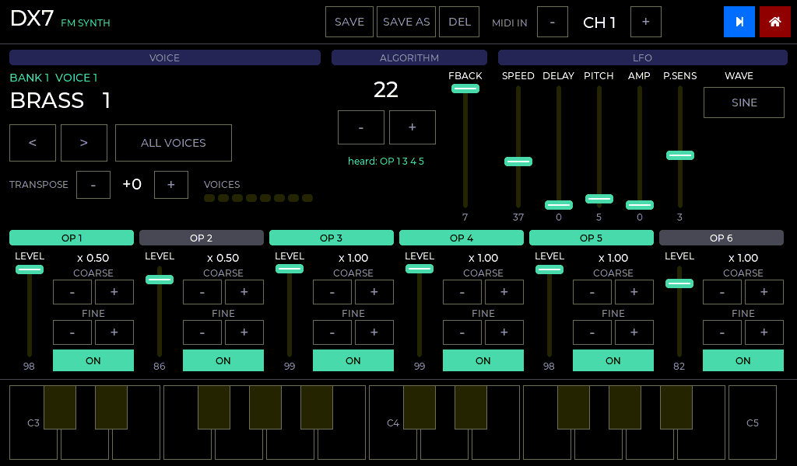
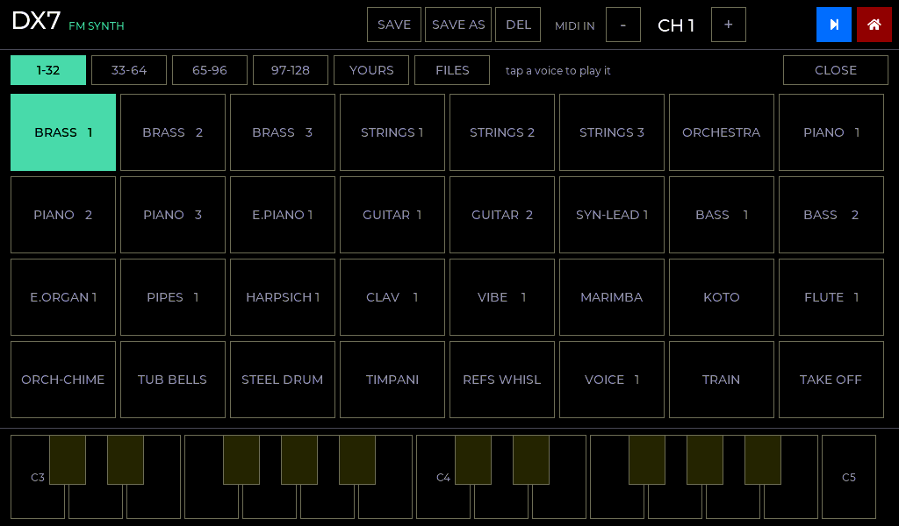

# DX7

A 6-operator FM synth for Tulip Studio (role: **SYNTH**) that plays DX7 voices, as the
Tulip does with AMY. The 128 voices the Tulip has are built in, and any DX7 bank
(`.syx`) you put in `/files/dx7/` plays as it is. It runs on its own from its tile on the
start page, or in the Studio, played from MIDI IN or from a sequencer track routed to it.

| The panel | ALL VOICES |
|---|---|
|  |  |

## The panel

* **VOICE:** where it came from (bank and number, YOURS, or the file), its name, **<**
  **>** to step through, **ALL VOICES**, **TRANSPOSE** in semitones, and 8 **VOICES**
  lights for what is sounding.
* **ALGORITHM:** **-** / **+** step through the 32. The operators heard (the carriers)
  are listed under it, and their tabs below light up. **FBACK** is the feedback, 0-7.
* **LFO:** **SPEED**, **DELAY**, its depth on **PITCH** and on **AMP**, **P.SENS** (pitch
  mod sensitivity) and the **WAVE**: TRI, SAW DN, SAW UP, SQUARE, SINE, S + H.
* **OP 1 - OP 6:** each operator's
  * **LEVEL** (0-99): for a carrier, how loud; for a modulator, how bright;
  * frequency: the ratio (x 0.50 to x 31) or, on fixed-frequency operators, Hz.
    **COARSE** - / + steps the ratio, **FINE** - / + (hold to run) nudges it;
  * **ON**: switch the operator off to hear what it adds. This is kept with the sound,
    but not written into the voice.

LEVEL changes take effect from the next note; everything else plays at once.

## Voices

* **ALL VOICES:** **1-32**, **33-64**, **65-96**, **97-128** (the Tulip's 128: brass,
  strings, pianos, organs, basses, bells, effects ...), **YOURS** and **FILES**.
  Tap one to play it; **CLOSE** goes back.
* **FILES** lists the `.syx` files in `/files/dx7/` (put them there from the launcher's
  web page or `tools/tulip.py`). Tap a file to see its voices, then tap one to play it.
  A 32-voice bank (4104 bytes) and a single voice (163 bytes) both work.
* **SAVE** keeps the sound over one of yours; on any other it asks for a name (10
  letters, the DX7's), like **SAVE AS**. **DEL** (tap twice) deletes one of yours. Yours
  are in `/files/dx7/voices.json`, 32 at most.
* The sound you were on is kept in `/files/dx7/dx7.json` a moment after a change; a Studio
  patch keeps it too.

## MIDI and notes

* **MIDI IN** - / + in the header: a channel 1-16, OMNI, or OFF (routed tracks only).
* Notes, velocity (each operator's velocity sensitivity, as in the voice) and the pitch
  wheel (2 semitones).
* 8 voices: a 9th note takes the voice released longest ago, else the oldest. A few
  effect voices (ST.HELENS) hold their sound after the key is let go, as they do on a
  DX7, until the voice is needed.

## How it is made

* `core/dx_dsp.c`: the engine, in plain C (tested on the PC: `tests/test_dx7.c`). The
  operators' envelopes, keyboard level and rate scaling, velocity and the pitch envelope
  follow the open-source MSFA engine (as in Dexed and AMY); the 32 algorithms are
  MSFA's table, with feedback on the operator that feeds itself.
* `core/dx_voice.c`: voice data, names, and reading `.syx` banks.
* `core/dx_presets.c`: the 128 voices, from AMY's `default-dx7-patches.bin` (MIT licence).
