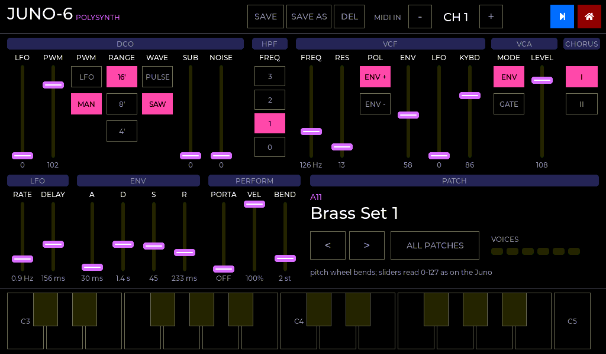
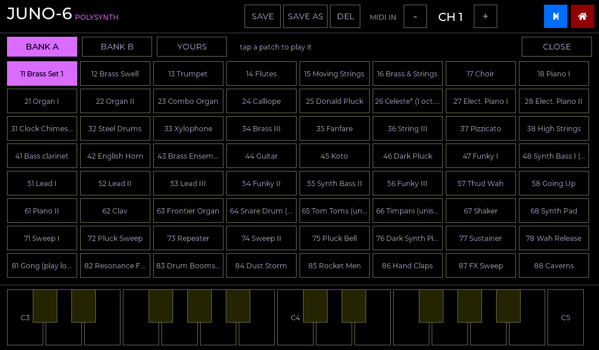

# JUNO-6

A 6-voice polysynth after the Roland Juno-6 / Juno-106 for Tulip Studio (role: **SYNTH**).
It is a port of the Tulip's Juno (`juno6.py`, on AMY's `juno.py`): the same controls,
the same curves, and the 128 Juno-106 factory patches. It runs on its own from its tile
on the start page, or in the Studio, played from MIDI IN or from a sequencer track
routed to it.

| The panel | ALL PATCHES |
|---|---|
|  |  |

## The panel

Laid out section by section, like the instrument. Drag a fader up or down anywhere on
its column; the number under it is the Juno's 0-127 (or a time or frequency).

* **DCO:**
  * **LFO:** how far the LFO moves the pitch (vibrato);
  * **PWM:** the pulse width. With **PWM LFO** the LFO sweeps it, with **MAN** it stays
    where the fader is;
  * **RANGE:** 16', 8' or 4';
  * **WAVE:** PULSE and SAW, each on or off (both at once is fine);
  * **SUB:** a square an octave down; **NOISE:** white noise.
* **HPF:** 3, 2, 1, 0. **1** is flat, **0** lifts the bass, **2** and **3** cut it.
* **VCF:** a 24 dB low-pass. **FREQ**, **RES** (the top few steps make it sing on its
  own, as the Juno's does), the envelope's amount **ENV** and its polarity **ENV + /
  ENV -**, **LFO**, and **KYBD** (how much the cutoff follows the keys).
* **VCA:** **ENV** (the envelope shapes the volume) or **GATE** (on / off with the key;
  the envelope then only moves the filter), and the **LEVEL**.
* **CHORUS:** **I**, **II**, or both for **I+II** (a fast, shallow shimmer). Off is mono.
* **LFO:** **RATE** and **DELAY** (the LFO fades in after each note).
* **ENV:** **A D S R**.
* **PERFORM** (not on the Juno): **PORTA** (glide between notes), **VEL** (how much
  velocity changes the volume; the Tulip's Juno plays at full velocity response, 100 %),
  **BEND** (the pitch wheel's range, in semitones).
* **PATCH:** the patch's bank and number, its name, **<** **>** to step through, and
  **ALL PATCHES**. The six **VOICES** lights show what is sounding.

## Patches

* **ALL PATCHES** shows them as the Juno-106 banks them: **BANK A** and **BANK B**, 8 x 8,
  and **YOURS**. Tap one to play it (the keys stay below to try it); **CLOSE** goes back.
* **SAVE** keeps your changes over one of yours; on a factory patch it asks for a name,
  like **SAVE AS**. **DEL** (tap twice) deletes one of yours. Yours are in
  `/files/juno/presets.json`.
* The sound you were on is kept in `/files/juno/juno.json` a moment after a change.
* A Studio patch keeps JUNO-6's sound and MIDI channel too.

## MIDI and notes

* **MIDI IN** - / + in the header: a channel 1-16, OMNI, or OFF (routed tracks only).
* Notes and the pitch wheel. A sequencer track routed to it plays it (a metroseq SLIDE
  glides).
* 6 voices: a 7th note takes the voice that has been released longest, else the oldest.

## How it is made

* `core/jn_dsp.c`: the voices, in plain C (tested on the PC: `tests/test_juno.c`).
  Per voice: a band-limited DCO (polyBLEP saw, pulse and sub), a 4-pole ladder VCF
  solved without a delay in its loop, a little drive; one LFO for every voice, with a
  fade-in per voice; the HPF and the BBD-style chorus on the mix.
* `core/jn_curves.h`: AMY's curves from the sliders to times, rates and frequencies.
* `core/jn_presets.c`: the 128 factory patches as 18-byte Juno-106 patch dumps, from AMY
  (MIT licence), with AMY's level trims for the loudest.
* Departures from the Tulip's version, both to match the instrument: VCA LEVEL 0 is quiet
  rather than silent, and the VCF self-oscillates at the top of RES (A82, B35 and a few
  others play only that).
