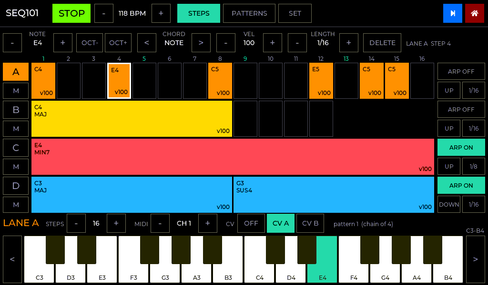
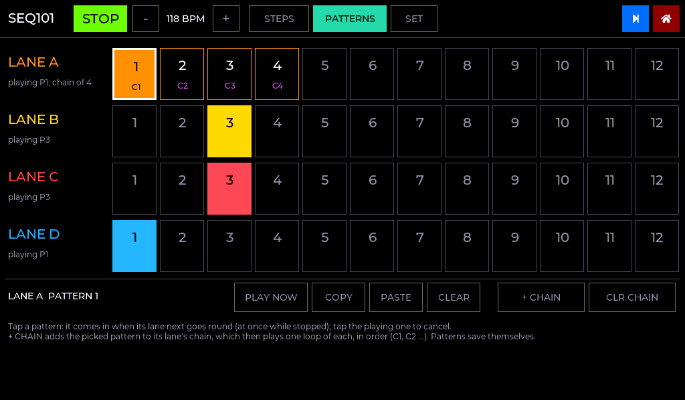
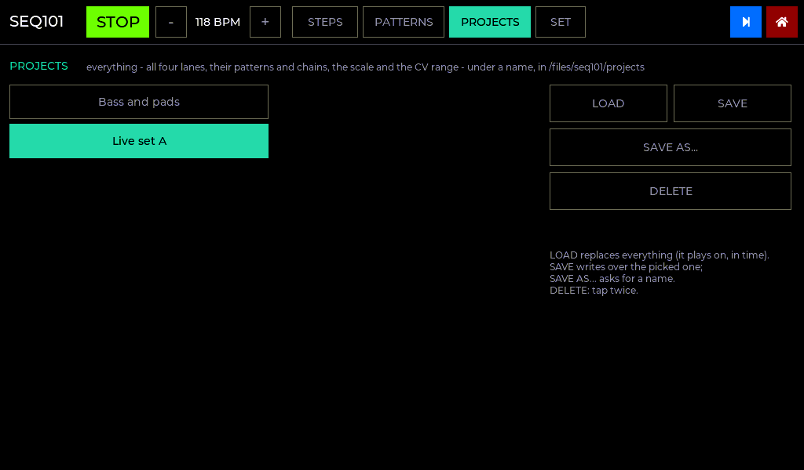

# SEQ101

A 4-lane, 16-step note sequencer for Tulip Studio (role: **SEQUENCER**). It runs on its
own from its tile on the start page, or in the Studio, where each lane can play a
synth on the Tulip.

| STEPS | PATTERNS |
|---|---|
|  |  |

## STEPS

Four lanes, A to D, of 16 steps each.

* **Adding and picking notes:**
  * tap an empty step to put a note there (the lane's last note);
  * tap a note to pick it.
* **The keyboard** under the lanes (two octaves): with a note picked, tap a key to change its note (the
  key lights up). With nothing picked, the key sets what new notes on that lane start as.
  `<` `>` move it an octave. With a scale set, its notes have a dot and the others are
  grey.
* **Editing the picked note** (the row along the top):
  * **NOTE -/+** moves it a semitone (with a scale, to the scale's next note), **OCT- /
    OCT+** an octave;
  * **CHORD** builds a chord on it: MAJ, MIN, SUS2, SUS4, 7, MAJ7, MIN7, 5TH, OCT;
  * **VEL** is the velocity;
  * **LENGTH** is how long it plays: 1/16, 1/8, 3/16, 1/4, 3/8, 1/2, 3/4 or a whole BAR.
    A long note spans its steps on the grid. It stops short of the next note and of the
    lane's end;
  * **DELETE** removes it.
* **Quick delete:** hold a note for about half a second, or tap it twice quickly.
* **Each lane's own controls:**
  * **A-D** picks the lane;
  * **M** mutes it;
  * **ARP** turns its arpeggiator on, which plays the chord's notes in turn over the
    note's length. **MODE** is UP, DOWN, UP/DN, RAND or ORDER, and **RATE** is 1/32,
    1/16, 1/8 or 1/4.
* **The picked lane's settings** (along the bottom):
  * **STEPS:** how many steps it loops over (1-16), so lanes of different lengths
    drift against each other;
  * **MIDI:** its MIDI OUT channel (OFF, 1-16). It gets every note of a chord;
  * **CV:** OFF, **CV A** (the Mabee DAC at 0x59) or **CV B** (0x58). VOUT0 is the gate
    (5 V) and VOUT1 the pitch, 1 V/oct with 0 V = C0.

## PATTERNS

Each lane has 12 patterns.

* **Tap a pattern** to choose it: it comes in when its lane next goes round, so lanes of
  different lengths each switch on their own loop. While stopped it comes in at once.
  Tap the playing one again to cancel a waiting switch.
* **PLAY NOW** switches straight away.
* **COPY / PASTE / CLEAR** work on the picked pattern, and can paste across lanes.
* **+ CHAIN** adds the picked pattern to its lane's chain (C1, C2 ...). The lane then plays
  one loop of each, in order, round and round. **CLR CHAIN** empties it.

Everything saves itself to `/files/seq101/state.json`, and goes into Studio patches.

## PROJECTS

A project is the whole sequencer under a name: all four lanes with their 12 patterns and
chains, lane settings, the scale and the CV range. Projects are kept in
`/files/seq101/projects/<name>.json`.

* **Tap a project** to pick it.
* **LOAD** replaces everything; if it's playing, it carries on in time.
* **SAVE** writes over the picked project. **SAVE AS...** asks for a name.
* **DELETE** removes the picked project (tap twice).

## SET

* **Clock:** the clock and MIDI clock out, the same panel every app has.
* **Scale:** a root (C-B) and a scale: CHROMATIC (off), MAJOR, MINOR, DORIAN, PHRYGIAN,
  LYDIAN, MIXOLYDIAN, HARM MINOR, PENTA MAJ, PENTA MIN or BLUES.
  * Every lane's notes, chords included, snap to the nearest scale note as they play,
    going down on a tie. A chord that ends up with a note twice plays it once.
  * The notes you entered aren't changed, so going back to CHROMATIC restores them.
* **CV pitch range:** **0-10 V** for eurorack, or **0-5 V** for AMYboard inputs, where
  notes above 5 V drop by octaves. On an AMYboard sketch (Megatron), set its **0V NOTE**
  to 12.

## Outputs, and sharing the DACs

* **One note per lane to CV and routing:** a chord sends its lowest note (or the arp's
  current note) to CV and to the Studio's routing. MIDI OUT gets the whole chord.
* **Routing in the Studio:** the home page lists LANE A-D like any sequencer's tracks.
  Route them to Sloe, Wavetron or MIDI OUT there.
* **The DACs** belong to one sequencer at a time: the first one switched on (SEQ101 or
  metroseq). The other keeps playing MIDI and routed notes. SET says who has them.

## Verification

* **The player on the PC** (`make -C tests test`, `tests/test_s101.c`):
  * note lengths;
  * a gate that falls a tick before the next note;
  * chords;
  * a 5-step lane looping on its own;
  * the arpeggiator;
  * a queued pattern on the loop crossover;
  * chains;
  * starting in step mid-bar;
  * mute;
  * the scales;
  * the JSON round trip.
* **Needs a Tulip:** the timing on the CV and MIDI ports, and touch on the grid.
